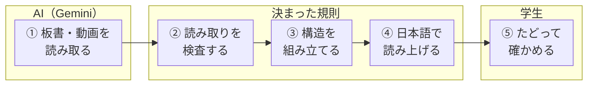
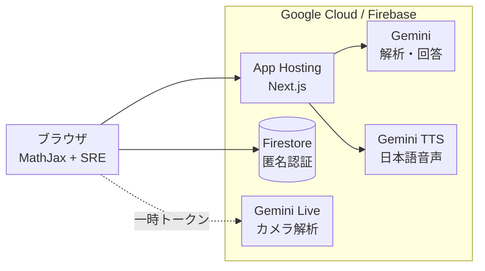

# MathVoice ― 見えない数式を、耳とキーボードでたどる

**板書の数式を「聞き流す」のではなく、分子・分母・ルートの中へ自分で入って確かめる。**
視覚障害のある大学生のための、数式アクセシビリティWebアプリです。DevFest GDGoC Japan Hackathon 2026（医療・福祉カテゴリ）向けに開発しました。

**[アプリを開く](https://mywebapp--hackathon-f647e.asia-east1.hosted.app/)** · **[1分デモを体験する](https://mywebapp--hackathon-f647e.asia-east1.hosted.app/demo)**
<!-- TODO: デモ動画のURLができたら、上の行の末尾に「 · **[デモ動画](URL)**」を足す -->

登録・ログインは不要です。キーボードだけで、すべての操作が完結します。

## 1分で試す

1. **[デモページ](https://mywebapp--hackathon-f647e.asia-east1.hosted.app/demo)** を開きます（音声が出ます）。
2. `Tab` で数式に移動し、`Enter` で数式の中に入ります。
3. `←` `→` で隣の部分へ、`↓` で一段深く（分子の中、ルートの中など）、`↑` で一段浅く移動します。今いる部分が日本語で読み上げられます。`Esc` で終了します。

目を閉じて試すと、「どこまでが分子で、どこからがルートか」を耳だけで確かめられることが分かります。自分の資料で試すときは、[トップページ](https://mywebapp--hackathon-f647e.asia-east1.hosted.app/)の「学習を始める」から、板書の写真や講義動画を取り込んでください。

## 解決したい課題

大学の講義では、教員が黒板やスライドに数式を書きながら説明が進みます。全国の大学・短期大学・高等専門学校には、視覚障害のある学生が1,366人在籍しています[^jasso]が、板書された数式に、自分の力でその場でアクセスする手段はほとんどありません。

友人に板書を撮影してもらい、OCRで文字にして読み上げさせると、数式は始めから終わりまで**一方向に読み上げる**形になります。

> エックス イコール マイナス ビー プラスマイナス ルート ビー 2乗 マイナス 4 エー シー 割る 2 エー

これを聞いて、「どこまでがルートの中か」「何を 2a で割るのか」を判断するのは困難です。聞き逃した部分だけを聞き直すこともできません。晴眼の学生は、分母 → 分子 → ルートの中と自由に視線を動かして数式を読んでいます。MathVoiceは、その「視線の移動」をキーボードと音声で再現します。

### 既存の手段との違い

| 手段 | 構造が分かる | 部分だけ聞き直せる | 日本語で聞ける | その場で質問できる | 板書から自分で取り込める |
|---|:---:|:---:|:---:|:---:|:---:|
| OCR＋読み上げ | — | — | ○ | — | ○ |
| 数式対応のスクリーンリーダー（MathML） | ○ | ○ | △ | — | —（電子教材が前提） |
| InftyReader＋ChattyInfty（数式OCRと読み上げ） | ○ | ○ | ○ | — | △（主に印刷物・PDF） |
| 生成AIに数式を説明させる | △（文章で説明） | — | ○ | ○ | ○ |
| TA・支援者による点訳やテキスト化 | ○ | ○ | ○ | — | —（後日） |
| **MathVoice** | **○** | **○** | **○** | **○** | **○（板書・講義動画をその場で）** |

数式を構造で読む技術そのものは、電子教材や印刷物向けにすでに存在します。MathVoiceが埋めるのは、**講義中の板書という「電子化されていない数式」を、その場で構造ごと取り込み、分からなければすぐ質問できる**部分です。

## テーマ「Own the Why, Build with Intent」との関連

**Own the Why：なぜ作り、なぜそれを選んだか**

- 数式を構造で読む技術は、電子教材向けにすでにあります。しかし講義の板書は電子化されておらず、その恩恵が届きません。私たちはこの「板書の数式」を、解くべき課題として定めました。
- 技術は比べて選びました。SREに日本語の読み上げ規則がないことを確かめて自作し、diagcessやCloud Video Intelligence APIなどは検証したうえで採用していません（[技術選定](#技術選定)）。

**Build with Intent：AIを鵜呑みにしない設計**

- AIの担当は「読み取り」と「説明」に限り、数式の構造は決まった規則で組み立て、AIの出力も規則で検査します（[AIに任せる範囲と、任せない範囲](#aiに任せる範囲と任せない範囲)）。
- 最後に判断するのは学生自身です。元の板書と見比べ、分からない部分はGeminiに質問して確かめます。
- 開発でもAIコーディング支援を使いましたが、採否はチームで判断しました。たとえば、構造探索の読み上げを端末の音声に戻すというAIの提案は採らず、自然な日本語で聞けることを優先してGemini TTSを維持しています。

## 主な機能

| 機能 | 内容 |
|---|---|
| 構造ナビゲーション | 数式の中を矢印キーで移動し、分子・分母・ルートの中・行列の行と列などを、日本語で一つずつ確認できます。数式にフォーカスすると、今使えるキーの操作ガイドが画面下に表示されます |
| 板書・動画からの取り込み | 板書の写真、講義動画、カメラの映像をGeminiが解析し、LaTeX数式・説明文・読み上げ用の台本に変換します |
| 読み取り結果の自動チェック | Geminiが読み取った数式を規則で検査し、括弧の対応が崩れているものや数式として組み立てられないものに「要確認」を表示します |
| 数式を指定して質問 | 「この数式について質問」で対象を選び、変数の意味や式変形の手順をGeminiに聞けます。講義全体の要約もできます |

ほかに、Gemini TTSによる自然な日本語音声（0.5〜2.0倍速）、グラフの音響化（yの値を音の高さ、xの位置を左右の定位で表現）、ブックマークと自分用メモ、取り込んだ板書画像との見比べに対応しています。

## AIに任せる範囲と、任せない範囲

MathVoiceでは、**AIが担うのは「読み取り」と「説明」だけ**です。数式の構造は、決まった規則で動く仕組みが組み立てます。



| 段階 | 担当 | 理由 |
|---|---|---|
| 画像・動画から数式を読み取る | Gemini | 手書きや崩れた板書でも、前後の文脈を踏まえてLaTeXに変換できるためです |
| 読み取り結果を検査する | 規則に基づくチェック（`src/lib/latex-check.ts`）とMathJaxの組み立て | AIの出力をAIで確かめず、括弧の対応や数式として成立するかをコードで判定します。問題があれば「要確認」と表示します |
| 数式の構造を組み立てる | MathJax＋SRE（規則に基づく処理） | 構造の木は、LaTeXから決まった規則で一意に組み立てます。AIの推測によって構造が変わることはありません |
| 構造を日本語で読む | 自作の日本語化規則 | 同じ数式は常に同じ言葉で読まれます。耳で学ぶ学生にとって、読み方が揺れないことが重要だからです |
| 理解できたかを判断する | 学生本人 | 元の板書画像と見比べ、分からない部分はGeminiに質問して、自分で確かめます |

AIの誤読は避けられません。そこで、誤読が「構造の誤り」として広がらないようにすることと、学生自身が元の資料に立ち返れることを設計の軸にしました。

## 仕組み



- Gemini APIキーはサーバー（App Hostingのシークレット）だけが持ち、ブラウザには渡しません。カメラのリアルタイム解析では、サーバーが発行した一時トークンだけをブラウザに渡します。
- 解析結果は講義ごとにFirestoreへ保存し、同じURLから何度でも読み直せます。
- 取り込んだ画像（IndexedDB）とメモ・ブックマーク（localStorage）は、利用者のブラウザ内に保存します。サーバーには送りません。

## 技術選定

| 技術 | 使用箇所 | 選定理由 | 比較した選択肢 |
|---|---|---|---|
| **Gemini 3.1 Flash Lite** | 画像・動画からの数式抽出、説明文と読み上げ台本の生成、質問への回答 | 1回の呼び出しで、LaTeX・視覚障害者向けの説明・読み上げ台本を構造化JSONでまとめて得られます。動画は映像と音声を同時に扱えるため、板書と講師の説明を時系列で抽出できます。軽量モデルなので、講義1回分を繰り返し解析しても費用を抑えられます | 従来のOCR（文字は取れても数式の構造と説明は得られない） |
| **Gemini TTS** | 説明・回答・構造読みの音声 | 日本語の数式読み上げに必要な、自然な間と抑揚が得られます。生成に失敗したときは、ボタン一つで端末の音声に切り替えられます | Web Speech API（端末によって日本語の音質と読みが大きく変わる） |
| **Gemini Live API** | カメラ映像からのリアルタイム抽出 | 板書を撮り直さずに、映し続けるだけで数式を拾えます。一時トークンを使うため、APIキーを公開せずにブラウザから直接接続できます | 一定間隔での静止画アップロード |
| **MathJax 3＋Speech Rule Engine** | 数式の表示と構造ナビゲーション | 数式の構造の木をキーボードで探索する仕組みが、アクセシビリティ分野で実績を持っています | 構造探索の自前実装／MathJax 4（移行の手間に見合う差がなかった） |
| **日本語の構造読み（自作）** | SREの読み上げを日本語へ変換 | SREには日本語の読み上げ規則がありません。分数・ルート・行列・連立方程式などの読みを日本語の規則として実装し、英語が混ざらないことをテストで確認しています | Geminiによる都度翻訳（同じ数式の読みが揺れ、遅延も出る） |
| **Firebase Authentication（匿名）＋Cloud Firestore** | 講義データの保存と共有 | 登録なしですぐ使い始められます。セキュリティルールで「作成者だけが書き込める」「講義の一覧は取得できない」ことを強制しています | 自前のDBとAPIサーバー |
| **Firebase App Hosting** | 画面とAPIの公開 | Next.jsの画面とAPIルートを1つの単位でデプロイでき、Gemini APIキーをシークレットとして扱えます。Firebaseと同じプロジェクトで管理できます | Cloud Runへの個別デプロイ |
| **Web Audio API** | グラフの音響化 | 追加のライブラリなしで、音の高さと左右の位置を細かく制御できます | 音声ファイルの事前生成 |

### 検証したうえで採用しなかったもの

| 候補 | 判断 | 理由 |
|---|---|---|
| diagcess（図の音声探索ライブラリ） | 不採用 | ライセンスが明示されておらず、利用実績もほぼないため |
| Cloud Video Intelligence API | 不採用 | 提供終了が予告されていたうえ、動画はGeminiが映像と音声をまとめて扱えるため |
| MathJax 4 | 見送り | 最新版だが移行の手間が大きく、必要な構造探索は3.2.2で満たせるため |
| Chirp 3（音声認識・合成） | 不採用 | Gemini Liveが音声の入出力を両方扱えるため |
| SREの日本語ロケール | 存在しなかった | 対応言語は英・仏・西・独・伊のみ。そこで日本語の構造読みを自作した |

## アクセシビリティの設計

- **キーボードだけで完結**：取り込み・閲覧・質問・メモまで、マウスを使わずに操作できます。各ページにスキップリンクがあります。
- **日本語専用の読み上げ領域**：MathJaxの英語の読み上げはスクリーンリーダーから隠し、日本語に変換した文だけを読み上げ領域に流します。
- **自分のペースで読める**：新しい内容が届いても、読んでいる位置を勝手に動かしません（自動で移動するモードにも切り替えられます）。未読の件数を表示し、「最新へ移動」で追いつけます。
- **速度調整**：説明・回答・構造読みに共通の速度を、0.5〜2.0倍で設定できます。設定はブラウザに保存されます。

## 安全性と保守性

- **秘密情報**：Gemini APIキーはApp Hostingのシークレットで管理し、リポジトリにもブラウザにも置きません。
- **データの守り**：Firestoreのセキュリティルールで、書き込みは作成者本人だけに限り、保存できる項目・型・件数を検証しています。講義の一覧は誰も取得できません。
- **入力の検証**：APIは、読み上げる文字数・質問の長さ・解析結果の件数に上限を設け、範囲外のリクエストはGeminiを呼ぶ前に拒否します。
- **費用の守り**：Geminiを呼ぶすべてのAPIに、接続元ごとの回数制限を設けています。公開URLが拡散しても、利用枠を一気に使い切られません。
- **障害への備え**：複数のAPIキーを登録でき、利用上限やサーバーのエラーが起きたときは自動で次のキーに切り替えます。音声生成に失敗したときは、端末の音声で読み上げを続けられます。
- **自動テスト**：日本語の構造読み、読み取り結果の検査、音声の再生と停止、音声API、元画像と復習記録の保存、APIキーの切り替えを、Node.js標準のテストランナーで検証しています。

## 今後の展望

- 視覚障害のある学生・大学の障害学生支援室と共同で検証し、読み方の規則を磨き込む
- 点字ディスプレイへの出力に対応し、音声と点字の両方で構造をたどれるようにする
- 物理・化学の式や、図形・回路図の構造説明へ対象を広げる
- 講義中にTAが取り込んだ内容を、学生の端末へリアルタイムに届ける運用の検証

## ローカルでの起動

Node.js 20以降が必要です。

```bash
git clone https://github.com/Devfest-Hackathon-2026/df-2026-t173.git
cd df-2026-t173
npm ci
cp .env.example .env.local
npm run dev
```

`.env.local` に次の値を設定し、http://localhost:3000 を開きます。

| 変数 | 内容 |
|---|---|
| `GEMINI_API_KEY` | [Google AI Studio](https://aistudio.google.com/apikey) で発行したキー。カンマ区切りで複数指定すると、自動で切り替えて使います |
| `GEMINI_MODEL` | 任意。解析と回答に使うモデル（既定は `gemini-3.1-flash-lite`） |
| `GEMINI_TTS_MODEL` | 任意。音声生成に使うモデル |
| `NEXT_PUBLIC_FIREBASE_*` | Firebaseコンソールの「ウェブアプリを追加」で得られる設定値 |

Firebase側では、Authenticationの**匿名ログイン**を有効にし、Firestoreを作成したうえで、リポジトリの `firestore.rules` を適用してください（`firebase deploy --only firestore:rules`）。

```bash
npm test        # 自動テスト
npm run lint    # 静的解析
npm run build   # 本番ビルド
```

## ディレクトリ構成

| パス | 内容 |
|---|---|
| `src/app/demo` | 1分デモ（課題の体験 → 構造ナビ → Geminiによる解析 → 質問） |
| `src/app/session/[id]` | 学習画面（取り込み・閲覧・質問・メモ） |
| `src/app/api` | Gemini呼び出し（`convert` 画像、`convert-video` 動画、`ask` 質問、`speech` 音声、`token` Live用の一時トークン） |
| `src/lib/gemini.ts` | 解析と回答のプロンプト・呼び出し |
| `src/lib/gemini-keys.ts` | APIキーの切り替えと障害時の再試行 |
| `src/lib/latex-check.ts` | Geminiが読み取った数式の規則による検査 |
| `src/lib/rate-limit.ts` | 接続元ごとのAPI回数制限 |
| `src/lib/japanese-math-speech.ts` | SREの読み上げを日本語へ変換する規則 |
| `src/lib/speech-player.ts` | 音声の生成・再生・停止・速度の制御 |
| `firestore.rules` | Firestoreのセキュリティルール |
| `tests/` | 自動テスト |

## ライセンスと出典

- 本リポジトリは [MIT License](LICENSE) です。
- 使用ライブラリ：Next.js・React・Tailwind CSS（MIT License）、MathJax・Firebase JS SDK・`@google/genai`（Apache License 2.0）ほか。
- デモページの講義動画：予備校のノリで学ぶ「大学の数学・物理」〈微分方程式入門①（微分方程式とは）〉（ヨビノリたくみ氏）をYouTubeの埋め込みで表示しています。

[^jasso]: 日本学生支援機構「[令和7年度（2025年度）大学、短期大学及び高等専門学校における障害のある学生の修学支援に関する実態調査](https://www.jasso.go.jp/statistics/gakusei_shogai_syugaku/2025.html)」（2025年5月1日現在、大学院を含む）。
